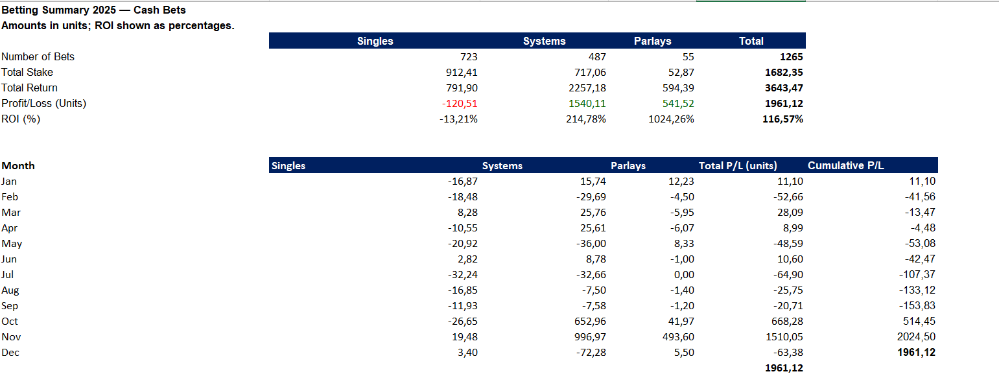
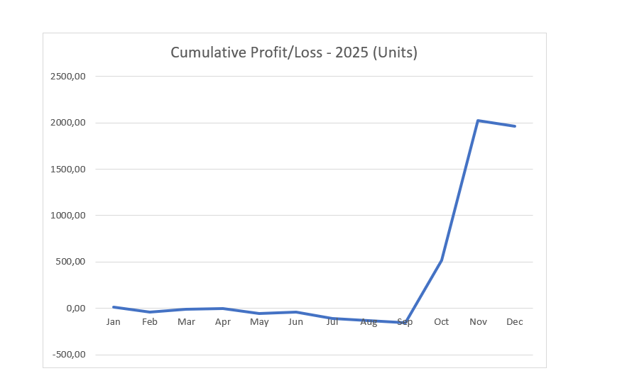
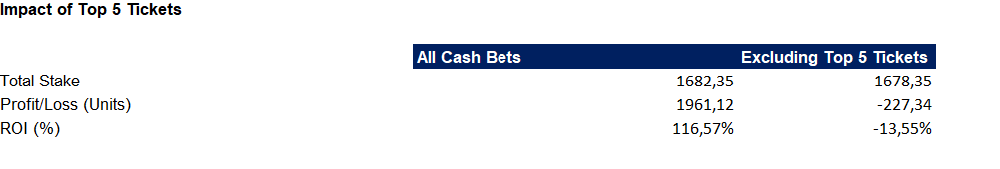

# 2025 Betting Data Analysis — Excel Portfolio Project

This project analyses personal betting records from 2025 using Microsoft Excel. It covers single bets, system bets and parlays, with a focus on data quality, profitability and the concentration of returns.

I organised the records into four linked tables, standardised inconsistent entries, validated calculations and built PivotTables and charts to explore the results.

The analysis shows how a positive annual result can depend heavily on a small number of large winning tickets. It describes historical outcomes and does not establish that a betting strategy will remain profitable.
## Dashboard Preview

## Dataset and Structure

The dataset contains personal betting records placed in 2025 from two bookmakers, anonymised as `Book_A` and `Book_B` in the public workbook.

It includes 1,266 tickets: 724 single bets, including one freebet, and 542 system/parlay tickets. The cash-bet analysis excludes the freebet, leaving 1,265 tickets.

The workbook uses four linked Excel Tables:

| Table | One row represents | Records |
|---|---|---:|
| Single_bets | One single bet | 724 |
| System_bets | One system or parlay ticket | 542 |
| System_Selections | One selection within a system or parlay | 2,279 |
| System_Components | One combination level and its unit stake within a ticket | 1,029 |

System_ID links each system/parlay ticket to its selections and staking components through one-to-many relationships.

Financial amounts are recorded at ticket level. This prevents the same stake or return from being counted repeatedly across selections.

### Public Reporting Units

All monetary amounts in the public workbook and this README are expressed in units. One fixed scaling factor was applied consistently to cash stakes, returns, profits/losses, bonus stakes and staking components. The conversion factor is not disclosed in the public project.

These are reporting units, not a flat-stake simulation: the original differences in ticket stakes are preserved. Scaling does not change odds, ticket counts, win rates or ROI. Amounts are presented to three decimal places where needed; calculations retain the underlying precision.

### Metric Definitions

- Stake: cash committed to the ticket, expressed in reporting units (`Stake_Units` or `Total_Stakes_Units`).
- Return: the recorded settlement amount credited back, including any returned stake, expressed in units (`Return_Units`).
- Profit/Loss: Return minus Stake.
- ROI: total Profit/Loss divided by total Stake.
- Selection Win Rate: Win selections divided by (Win + Loss) selections; Void selections are excluded.
- Profitable Ticket Rate: tickets with positive Profit/Loss divided by the number of tickets in the analysed group.

Monthly results are grouped by the recorded placement date, rather than the settlement date.

The freebet is identified separately using `Stake_Type` and `Bonus_Stake_Units`. It is excluded from the cash-bet summaries.

## Data Cleaning and Validation

I standardised team names, competition names, bet types and selection descriptions across the dataset. This included correcting spelling variations, removing unnecessary spaces and replacing inconsistent abbreviations.

I separated selection results from settlement methods, preserving information about early payouts and cash outs. Freebet stakes were also recorded separately from cash stakes.

Validation checks covered:

- Unique ticket IDs and valid links between the tables.
- Agreement between each ticket’s declared selection count and its recorded selections.
- Agreement between total ticket stakes and the sum of their staking components.
- Verification that Profit/Loss equals Return minus Stake.
- Consistent dates, numeric values and result categories.

The analysis also identified a Trixie recorded with two losing selections despite a positive Profit/Loss. After checking the original ticket history, I corrected it to two winning selections and one losing selection. This demonstrated how analytical checks can reveal data-entry errors.

## Excel Techniques

Function names below use their English equivalents; the workbook was developed in German-language Excel.

The workbook uses:

- Excel Tables and structured references to organise the records and maintain formulas.
- TRIM and SUBSTITUTE to clean text, including non-breaking spaces.
- COUNTIFS to count winning, losing and void selections for each ticket.
- IF and ISNUMBER to classify ticket profitability and flag records requiring review.
- PivotTables and calculated fields to summarise ticket counts, stakes, Profit/Loss and ROI.
- GETPIVOTDATA to connect the Overview sheet to PivotTable results.
- Column and line charts to show monthly results and cumulative Profit/Loss.
- Sensitivity analysis to examine how the largest winning tickets affected annual results.

## Key Findings

### Annual Results

The analysis covered 1,265 cash-funded tickets, with total stakes of **1,682.345 units**, returns of **3,643.467 units** and net profit of **1,961.122 units**. Overall ROI was 116.57%.

| Bet Format | Tickets | Total Stake (units) | Net Profit/Loss (units) | ROI |
|---|---:|---:|---:|---:|
| Singles | 723 | 912.413 | −120.509 | −13.21% |
| Systems | 487 | 717.063 | 1,540.113 | 214.78% |
| Parlays | 55 | 52.869 | 541.518 | 1,024.26% |
| Total | 1,265 | 1,682.345 | 1,961.122 | 116.57% |

### Concentration of Profits

The five largest winning tickets generated **2,188.466 units** in net profit, exceeding the annual net profit because the remaining tickets collectively produced a loss.

Excluding those five tickets and their combined **4.000-unit stake**, the remaining bets recorded a net loss of **227.344 units** and ROI of −13.55%.

This retrospective sensitivity analysis shows how strongly the annual result depended on a small number of large wins. It does not estimate future performance.

### Single-Bet Performance

Match Winner and Bet Builder accounted for 627 of the 723 cash single bets. Their ROI was −10.38% and −13.24%, respectively.

Bet Builder had a higher recorded win rate than Match Winner—24.11% versus 21.60%—but a lower ROI. This illustrates why win rate alone is insufficient to assess profitability: odds, stake sizes and settlement conditions also affect returns.

### System Outcomes

Only 44 of 487 system tickets were profitable (9.03%), despite positive aggregate system profits. The frequency of profitable tickets and the size of their returns therefore tell different parts of the story.

Among systems with exactly one losing selection, 34 of 37 were profitable (91.89%). The three unprofitable tickets each also contained a void selection. All 34 tickets with exactly one losing selection and no void selections were profitable in this dataset.

These figures describe the recorded sample and should not be interpreted as general probabilities for these system types.

## Limitations

- **Scope:** The dataset covers one individual’s recorded betting activity in 2025. It is not representative of other bettors or future periods.

- **Manual data entry:** Records were entered manually. Validation checks identified and corrected inconsistencies, but internal consistency does not guarantee that every entry matches the original bookmaker history.

- **Small subgroups:** Some bet types contain only a few tickets. Their ROI can be heavily affected by a single result, making comparisons uncertain.

- **Shared selections:** Different tickets sometimes include the same matches or selections. Their outcomes are therefore not independent.

- **Profit concentration:** A small number of large winning tickets strongly influenced annual profitability. Positive historical ROI does not establish a repeatable advantage.

- **Retrospective exclusions:** The largest-ticket sensitivity analyses select tickets after their outcomes are known. They illustrate concentration rather than predict alternative future results.

- **Settlement differences:** Early payouts, cash outs and void selections affect recorded outcomes. Selection win rates reflect bookmaker settlement results, which may differ from results based solely on final match scores.

- **Timing:** Monthly summaries group final ticket outcomes by placement date. They do not represent monthly account cash flow or the account balance available at each point in time.

This project demonstrates data organisation, cleaning, validation and exploratory analysis in Excel. It does not provide betting recommendations or forecasts.

## AI Assistance

AI tools assisted with data-model design, Excel formula guidance, interpretation and documentation. I entered and cleaned the data, implemented the workbook, and checked identified discrepancies against the available ticket history.
